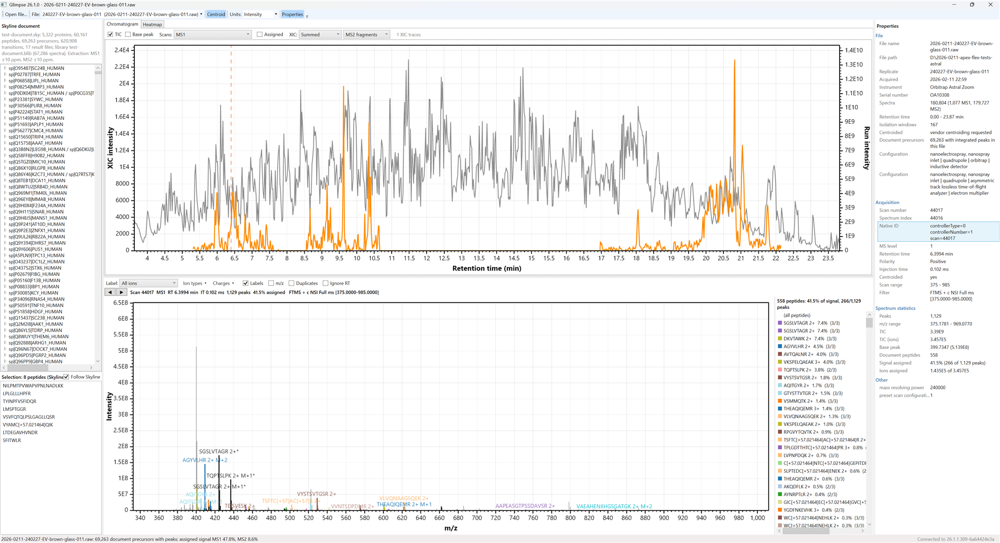
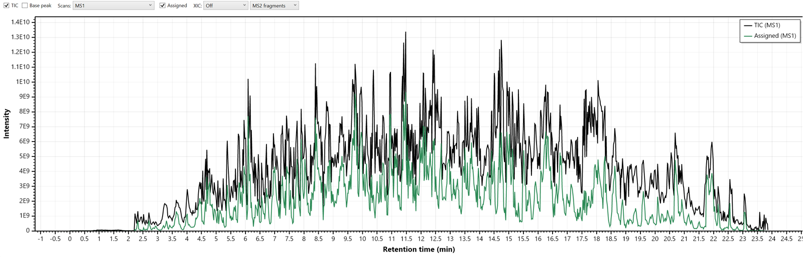
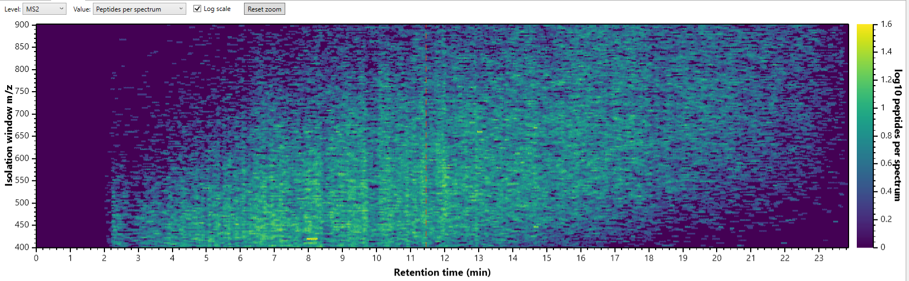
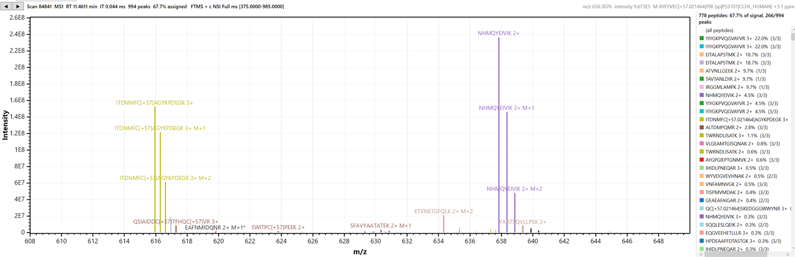

<p align="center">
  
</p>

# Skyline Glimpse

[](https://github.com/maccoss/skyline-glimpse/releases/latest)
[](https://github.com/maccoss/skyline-glimpse/releases)
[](https://opensource.org/licenses/Apache-2.0)
[](https://dotnet.microsoft.com/)
[](https://skyline.ms)
[](https://www.microsoft.com/windows)

A raw-data browser for the open Skyline document, in the spirit of Thermo QualBrowser / FreeStyle and
SeeMS, that also shows **which signal belongs to which peptide and protein in the document**.

Glimpse runs as a Skyline External Tool. It reads the document's targets, transitions and integrated
peak boundaries from the running Skyline, opens the data file of the replicate Skyline is showing, and
lets you browse that file with every peak traced back to the peptide that explains it.



*An Orbitrap Astral DIA run against a 69,000-precursor document. Top: the MS1 TIC (gray) with the
summed XIC of the peptides selected in Skyline (orange). Bottom: the MS1 spectrum at the dashed line,
each peak colored and labeled by the peptide it belongs to, with the 558 peptides eluting there listed
on the right. Left: the document's proteins and the current selection. Right: the properties of the
file and spectrum.*

## What you can look at

### Chromatograms and XICs

- **TIC and base peak**, over all scans, MS1, MS2, or a single DIA isolation window.
- **Intensity or ions.** Orbitrap and Astral intensities are ion arrival rates (ions/s). Switching
  units to *Ions* multiplies each point by its scan's injection time, Skyline's own convention
  (`intensity x injection time / 1000`).
- **XICs for any number of peptides**, with no top-N cap: one per peptide, each in its own color as
  in the spectrum (the default for up to 100 peptides), one per protein, or one summed trace. The XICs
  use the peptides' MS1 precursor isotopes or their MS2 document transitions. Selecting a protein draws
  all of its peptides.
- **Integrated peaks.** With *Integrated only* on (the default), each XIC is drawn only between
  Skyline's integration boundaries in this file, so the trace is the peak Skyline integrated. Clear it
  to see the minute around each peak as well.
- **One intensity axis.** The TIC, base peak, assigned signal and XICs share one axis, so an XIC shows
  as the fraction of the TIC it is. A peptide's fragment XIC is often a millionth of an MS1 TIC; tick
  *Scale XICs separately* to give the XICs their own axis on the right.
- **Click a peptide's trace** to open the spectrum at that point, with that peptide in focus.


*Per-peptide XICs of the eight peptides selected in Skyline (MS2 fragments). Clicking the brown trace
opened the MS2 spectrum at its apex: VYAMC[+57]QIK's fragment ions are labeled, the other peptides in
the isolation window are dimmed, and the properties panel shows the peptide's integrated peak,
q value, and library match.*

- **Assigned signal.** The *Assigned* toggle draws, under the TIC, the signal claimed by document
  peptides inside their integrated peaks. Each peak counts once, however many peptides claim it
  (Skyline-PRISM's ion-accounting rule).



### Heatmaps

m/z by retention time, for MS1 (peaks binned by m/z) or MS2 (each scan's signal across its isolation
window). Click any cell to open that spectrum. Three values can be shown:

- **Intensity**, on a log scale.

  

- **Peptides per spectrum**: how many document precursors are inside their integrated peak at that
  time and, for MS2, inside that isolation window. This shows where the method is crowded.

  

- **Assigned fraction**: the share of each scan's signal that document peptides explain.

  

### Annotated spectra

- **Every document peptide in the spectrum is labeled**, its peaks colored by peptide. In MS1, a
  precursor isotope names its peptide and charge ("AGYVLHR 2+ M+2"); in MS2, fragments carry their ion
  names ("y7", "b4++"). A peak that matches more than one ion is marked with `*`, and the hover tooltip
  lists every owner.
- **The legend** lists the peptides in the spectrum with the share of signal each explains. Click one
  to focus it and dim the rest.
- **Choose what is labeled**, as in Skyline's spectrum graph: the document's transitions, the ions
  found in the library spectrum, or all ions of the chosen types (a, b, c, x, y, z) and charges. You can
  also show m/z values, show every ion on a shared peak, or ignore retention time to see what could be
  in an MS2 window.
- **Step through scans** with the arrow keys.



*An MS1 spectrum at 11.46 min, zoomed to 608-650 m/z: the isotope envelopes of
ITDNMFC[+57]AGYKPDEGK 3+ (peaks 0.33 m/z apart) and NHMQYEIVIK 2+ (0.5 m/z apart), each peak named
by its peptide, charge and isotope. Gray peaks belong to no document peptide.*

### Properties panel

A panel you can show or hide, modeled on Skyline's Full-Scan properties:

- **File:** path, replicate, instrument, acquisition date, and the number of spectra and isolation
  windows.
- **Acquisition:** scan number, MS level, retention time, isolation window, injection time, and
  dissociation method.
- **Spectrum statistics:** peak count, TIC in intensity and ions, base peak, and how many peptides and
  how much signal are assigned.
- **Focused peptide:** protein, gene, modified sequence, charge, integrated peak, detection q value,
  and dot products.
- **Library match:** the BiblioSpec entry's source and ID files, score, library retention time, and a
  dot product against the spectrum on screen.

### Selecting proteins and peptides

In Glimpse's document tree, click a protein, peptide or precursor to select it. Ctrl+click adds or
removes one, Shift+click selects the rows from the last click to this one (Ctrl+Shift+click adds them),
and Ctrl+A selects every protein. Any mix works: several proteins, or peptides from different proteins.

With *Follow Skyline* on, the selection stays in step with Skyline's Targets view in both directions.
Selecting in Skyline selects and scrolls to the same elements in Glimpse, and selecting in Glimpse
selects them in Skyline (up to 1,000 elements at a time).

### Zooming

On any plot, left-drag a rectangle to zoom into it, scroll the wheel to zoom, middle-drag to pan, and
right-drag to stretch an axis. *Reset zoom* above the plot, a double-click or a middle-click returns to
the whole run or spectrum, with intensity from zero.

## Speed

Measured on a 69,000-precursor, 620,000-transition, 17-replicate document with Astral DIA runs:

| Step | Time |
|---|---|
| Read the document (targets, transitions, settings, library) | 4.5 s |
| Fetch one file's integrated peaks | 2-4 s |
| One pass over a 180,000-spectrum run, measuring every document peptide's signal in the same pass | about 80 s |

The TIC is drawn while the file is still being read, so the run takes shape within seconds.

## Install in Skyline

Requires Skyline-daily, the .NET 10.0 Desktop Runtime, and Windows 10 version 2004 or later.

1. In Skyline, choose Tools > External Tools > Add > From File..., and pick `SkylineGlimpse.zip`.
2. Open a document with results, then choose Tools > Glimpse...

Glimpse connects to the document it was launched from and opens the replicate Skyline is showing.
Every data file imported into the document is listed under *File* (grayed when it is not on disk),
so any replicate is one pick away. Glimpse also runs on its own: `SkylineGlimpse.exe <data file>`, or Open file... in the window.

Glimpse reads Thermo `.raw`, mzML and mzXML for now (see [Vendor readers](#vendor-readers)).

## Build

Glimpse is .NET 10 / WPF / ScottPlot 5. It reads data files with
[pwiz-sharp](https://github.com/ProteoWizard/pwiz), the .NET port of ProteoWizard, which it expects as
a sibling checkout:

```
<parent>/
  maccoss/skyline-glimpse/          (this repository)
  ProteoWizard/pwiz/pwiz-sharp/     (the reader)
```

Point elsewhere with `-p:PwizSharpDir=<path>/pwiz/pwiz-sharp`. The Thermo SDK is license-gated;
`Directory.Build.rsp` passes `-p:IAgreeToVendorLicenses=true` to every build.

```powershell
dotnet build Glimpse.sln
dotnet test Glimpse.sln
pwsh build/package-and-verify.ps1     # version check, tests, publish/SkylineGlimpse.zip, launch check
```

`GLIMPSE_BIG_RAW=<path to a .raw>` makes the test suite time a full pass over a real run.

### Test quality

```powershell
pwsh build/coverage.ps1      # line coverage of Glimpse's own code, per project and class
pwsh build/mutation.ps1      # Stryker.NET mutation testing: do the tests catch planted bugs?
```

Coverage shows which code the tests ran; the mutation score shows whether a wrong answer in that code
would have failed a test. Reports land in `build/mutation/<project>/reports/`.

### Releases

Versions follow Skyline-PRISM's CalVer scheme, `YY.feature.patch` (for example `26.1.0`), bumped only
at release time. Release notes accumulate in
[`release-notes/RELEASE_NOTES_next.md`](release-notes/RELEASE_NOTES_next.md); the release steps are in
[`CLAUDE.md`](CLAUDE.md#releases).

## Vendor readers

pwiz-sharp and the Thermo reader are **bundled for now**. Skyline will soon ship on .NET 10 with
pwiz-sharp and every vendor reader in its own installation. Glimpse will then load those from the
running Skyline instead of carrying copies (`-p:GlimpseReaders=Skyline`, see `Pwiz.props`), and read
every format Skyline does. Only `Glimpse.Pwiz` touches pwiz types, so that switch is confined to one
project.

## Layout

| Project | |
|---|---|
| `src/Glimpse.Core` | Pure logic: document model, scan index, peptide assignment, chromatograms, heatmaps, XICs |
| `src/Glimpse.Library` | BiblioSpec `.blib` reader |
| `src/Glimpse.Plotting` | ScottPlot plottables (spectrum sticks, many-trace XICs) and the figure style |
| `src/Glimpse.Pwiz` | The reader seam: `IMsDataSource` over pwiz-sharp |
| `src/Glimpse.Skyline` | Skyline JSON-RPC connection and report loading (vendored client in `external/SkylineTool`) |
| `src/Glimpse.App` | WPF window and tool-inf manifest |
| `tests/Glimpse.Tests` | xUnit, using pwiz's Thermo test files and a fake Skyline that speaks its pipe protocol |
| `docs/logo` | The icon and logo drawings (SVG); `pwsh build/make-icon.ps1` renders them into `glimpse.ico` and the README logo |
