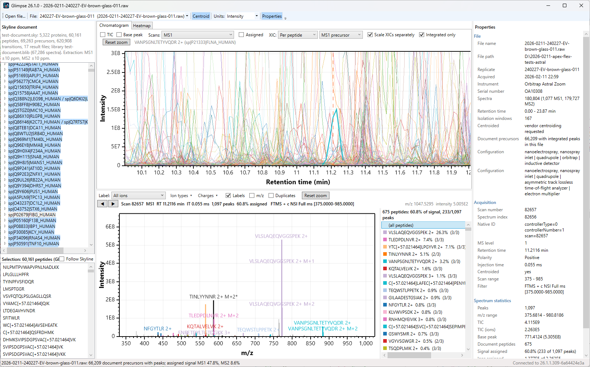
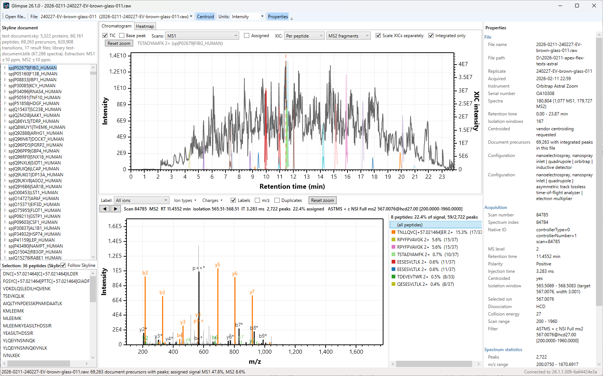
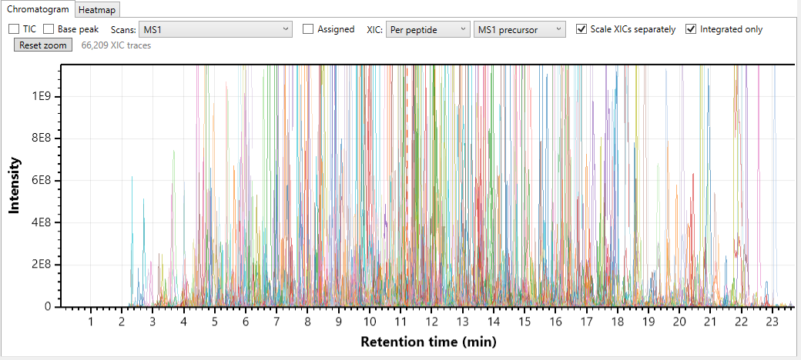
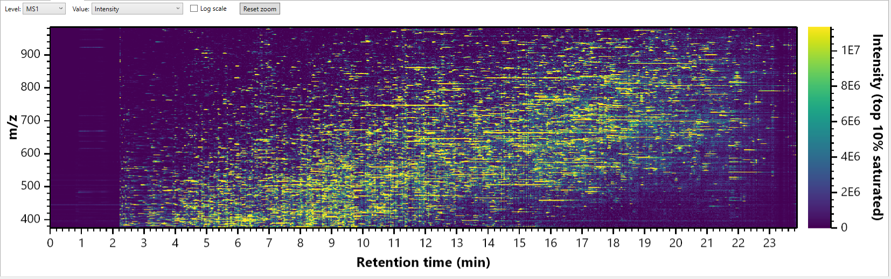
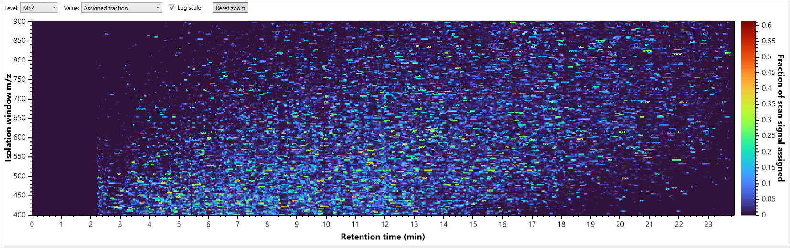
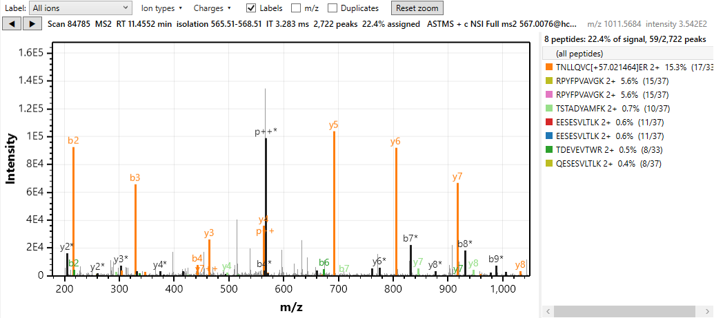

<p align="center">
  
</p>

# Skyline Glimpse

[](https://github.com/maccoss/skyline-glimpse/actions/workflows/ci.yml)
[](https://github.com/maccoss/skyline-glimpse/releases/latest)
[](https://github.com/maccoss/skyline-glimpse/releases)
[](https://opensource.org/licenses/Apache-2.0)
[](https://dotnet.microsoft.com/)
[](https://skyline.ms)
[](https://www.microsoft.com/windows)

A raw-data browser for the open Skyline document, in the spirit of Thermo QualBrowser / FreeStyle and
SeeMS, that also shows **which signal belongs to which peptide and protein in the document**.

Glimpse runs as a Skyline External Tool. It reads the document's targets, transitions and integrated
peak boundaries from the running Skyline, opens the data file of the replicate Skyline is showing, and
lets you browse that file with every peak traced back to the peptide that explains it.



*An Orbitrap Astral DIA run against a 69,000-precursor document, with every protein selected. Top: the
MS1 XICs of all 60,161 peptides (66,209 precursor traces), zoomed to 10-12 min, each in its peptide's
color; the highlighted trace is the one under the mouse. Bottom: the MS1 spectrum at the dashed line,
where 675 document peptides explain 61% of the signal, each peak labeled by the peptide it belongs to.
Left: the document's proteins and the selection. Right: the properties of the file, spectrum and
focused peptide.*

## What you can look at

### Chromatograms and XICs

- **TIC and base peak**, over all scans, MS1, MS2, or a single DIA isolation window.
- **Intensity or ions.** Orbitrap and Astral intensities are ion arrival rates (ions/s). Switching
  units to *Ions* multiplies each point by its scan's injection time, Skyline's own convention
  (`intensity x injection time / 1000`), and divides by the α of the analyzer that recorded the scan
  when the instrument has one (see [Settings](#settings)), so ion counts compare across instruments.
- **XICs for any number of peptides**, with no top-N cap: per peptide (the default for up to 100
  peptides), one per protein, or one summed trace. Per peptide, each charge state is its own trace,
  labelled as in the spectrum ("WYNLAIGSTC[+57]PWLK 2+") and drawn in its peptide's color, lighter for
  the higher charges. The XICs
  use the peptides' MS1 precursor isotopes or their MS2 document transitions. Selecting a protein draws
  all of its peptides.
- **Integrated peaks.** With *Integrated only* on (the default), each XIC is drawn only between
  Skyline's integration boundaries in this file, so the trace is the peak Skyline integrated. Clear it
  to see the minute around each peak as well.
- **Each signal counted once.** A summed or per-protein XIC adds up the peaks its precursors claimed
  inside their integrated peaks, each peak once. A peptide listed under two proteins, or two precursors
  whose windows catch the same peak, never count the same signal twice, so a summed XIC stays at or
  below the TIC. The sum of every peptide equals the *Assigned* signal.
- **XIC axis.** *Scale XICs separately*, on by default, gives the XICs their own axis on the right:
  a peptide's fragment XIC is often a millionth of an MS1 TIC. Clear it to put every trace on one axis,
  so an XIC shows as the fraction of the TIC it is.
- **Click a peptide's trace** to open the spectrum at that point, with that peptide in focus.
- **The time axis stays on the whole run** while the TIC, base peak or assigned trace is drawn, so
  clicking from protein to protein keeps the view. With the XICs drawn alone, a new selection of up
  to 50 traces is zoomed to.



*Fibrinogen gamma's 36 peptides selected in Skyline: their MS2 fragment XICs (right axis) over the
whole-run MS1 TIC. Clicking a trace at 11.46 min opened that DIA scan: six document peptides share
the 3 m/z window, and TNLLQVC[+57]ER's b and y ions explain 15% of its signal. Black peaks marked `*`
are claimed by more than one peptide.*



*No top-N cap: all 60,161 peptides of the document, one MS1 XIC per precursor, across the 24-minute
run (intensity zoomed to the bulk of the peaks).*

- **Assigned signal.** The *Assigned* toggle draws, under the TIC, the signal claimed by document
  peptides inside their integrated peaks. Each peak counts once, however many peptides claim it
  (Skyline-PRISM's ion-accounting rule).


### Peptide-like signal

How much of a run's signal could be peptides, and how much of that the document explains. While a file is
read, Glimpse finds the isotope envelopes in every MS1 scan, and in every MS2 scan of a DIA run, on worker
threads, with a C# port of Hardklor (Hoopmann et al., Anal. Chem. 2007). After the pass it links them across
scans as Bullseye's Kronik does (Hsieh et al., J. Proteome Res. 2010): an envelope found in at least 3 scans,
at the same charge within 10 ppm, with one missed scan allowed, is peptide-like. MS2 envelopes are linked
within each isolation window; DDA runs are MS1 only.

The **Peptide-like** trace sums the peaks of those envelopes in each scan, next to the TIC and the Assigned
trace: the gap between Peptide-like and Assigned is signal that looks like peptides but no document peptide
explains, and the rest of the TIC is signal there is little chance to identify. Settings can restrict MS1 to
multiply charged envelopes; MS2 counts every charge. Ion trap scans (a Stellar, a Tribrid's linear ion trap)
are not searched: they cannot resolve the isotopes of multiply charged ions.

The isotope model uses pwiz's isotope tables with 13C at 1.084% (Dwight Matthews' value, as in IDCalc and
Hardklor) and spaces isotope peaks by 1.00286864 Da, Monocle's averagine spacing (Rad et al., J. Proteome Res.
2021), which fits observed isotope peaks within about 1 ppm. With Hardklor's own spacing the port finds exactly
Hardklor.exe's envelopes; with Monocle's it agrees with Skyline's Hardklor configuration on about 98%.

On a 174,000-spectrum Orbitrap Astral Zoom DIA run the search finished 6 s after the pass, finding 72% of the
MS1 signal and 38% of the MS2 signal peptide-like.

The search is saved beside the raw file as `run.hk` (or in `%LOCALAPPDATA%\SkylineGlimpse\cache` when that
folder cannot be written), and reopening the file reads it instead of searching again. It is a Parquet file
with one row per isotope envelope: scan, MS level, retention time, series (MS1 or DIA window), monoisotopic
mass, charge, intensity, base peak m/z, correlation, m/z range, the persistent feature it belongs to, and its
scan's peptide-like signal. It is replaced when the raw file or the search settings change. For the run above
it is 396 MB, written in 4 s and read in 5 s.

### Heatmaps

m/z by retention time, for MS1 (peaks binned by m/z) or MS2 (each scan's signal across its isolation
window). Click any cell to open that spectrum. Three values can be shown:

- **Intensity**, linear with the brightest 5% of cells saturated (so faint signal still shows), or on
  a log scale.

  

- **Peptides per spectrum** (MS2): how many document precursors are co-isolated in each MS2 scan,
  inside the precursor range Skyline extracts from it (by the document's isolation scheme) and inside
  their integrated peak at that time, on a linear scale. This shows where the method is crowded.

  

- **Assigned fraction**: the share of each scan's signal that document peptides explain.

  

### Annotated spectra

- **Every document peptide in the spectrum is labeled**, its peaks colored by peptide. In MS1, a
  precursor isotope names its peptide and charge ("AGYVLHR 2+ M+2"); in MS2, fragments carry their ion
  names ("y7", "b4++"). A peak that matches more than one ion is marked with `*`, and the hover tooltip
  lists every owner. A peptide listed under several proteins is one peptide here: labeled, listed and
  counted once.
- **The legend** lists the peptides in the spectrum with the share of signal each explains. Click one
  to focus it and dim the rest.
- **Choose what is labeled**, as in Skyline's spectrum graph: the document's transitions, the ions
  found in the library spectrum, or all ions of the chosen types (a, b, c, x, y, z) and charges. You can
  also show m/z values, or show every ion on a shared peak.
- **Step through scans** with the arrow keys.



*The DIA scan above, zoomed: each fragment is colored by its peptide and named by its ion, and the
legend gives each peptide's share of the scan's signal and the number of its ions matched.*


*An MS1 spectrum at 14.80 min, zoomed to 655-672 m/z: the isotope envelopes of KANLQIDQINTDLNER 3+,
LASTLVHLGEYQAAVDGAR 3+ and ALQQYTLEPSEKPFDLK 3+ (peaks 0.33 m/z apart), each peak named by its
peptide, charge and isotope. Gray peaks belong to no document peptide.*

### Properties panel

A panel you can show or hide, modeled on Skyline's Full-Scan properties:

- **File:** path, replicate, instrument, acquisition date, and the number of spectra and isolation
  windows.
- **Acquisition:** scan number, MS level, retention time, isolation window, injection time,
  dissociation method, and the analyzer that recorded the scan, with its ion calibration α.
- **Spectrum statistics:** peak count, TIC in intensity and ions, base peak, and how many peptides and
  how much signal are assigned.
- **Focused peptide:** protein, gene, modified sequence, charge, integrated peak, detection q value,
  and dot products.
- **Library match:** the BiblioSpec entry's source and ID files, score, library retention time, and a
  dot product against the spectrum on screen.

### Selecting proteins and peptides

In Glimpse's document tree, click a protein, peptide or precursor to select it. Ctrl+click adds or
removes one, Shift+click selects the rows from the last click to this one (Ctrl+Shift+click adds them),
and Ctrl+A selects every protein. Any mix works: several proteins, or peptides from different proteins.

With *Follow Skyline* on, the selection stays in step with Skyline's Targets view in both directions.
Selecting in Skyline selects and scrolls to the same elements in Glimpse, and selecting in Glimpse
selects them in Skyline (up to 1,000 elements at a time).

### Zooming

On any plot, left-drag a rectangle to zoom into it, scroll the wheel to zoom, middle-drag to pan, and
right-drag to stretch an axis. *Reset zoom* above the plot, a double-click or a middle-click returns to
the whole run or spectrum, with intensity from zero.

### Settings

*Settings...* on the toolbar opens two tabs, saved in `%LOCALAPPDATA%\SkylineGlimpse\settings.json`:

- **Plots:** font sizes (axis titles, tick labels, legend, spectrum peak labels), the axis frame and
  tick sizes, and the line widths of the TIC, XICs and spectrum sticks. Text and lines grow with a larger
  plot unless you turn that off.
- **Ion calibration:** the α of each instrument's analyzers. An Orbitrap or Astral reports
  `intensity = α x ions / injection time`, with α a fixed property of the analyzer, so ions are
  `intensity x injection time / 1000 / α`. The table starts with the values measured by Hsu et al.,
  J. Proteome Res. 2025, 24, 5742 (Table 1):

  | Instrument | Astral | Orbitrap | Ion trap |
  |---|---|---|---|
  | Orbitrap Astral Zoom | 1.31 | 10.30 | |
  | Orbitrap Astral | 1.53 | 10.62 | |
  | Orbitrap Exploris 480 | | 10.95 | |
  | Orbitrap Ascend | | 9.40 | 0.98 |
  | Orbitrap Fusion Lumos | | 15.44 | 1.09 |
  | Stellar | | | 0.97 |

  Add or edit rows for other instruments; the name must match the instrument shown in the Properties
  panel. A scan from an analyzer without a row, or from a file whose instrument model is unknown, uses
  α 1: ions are intensity x injection time / 1000.

## Speed

Measured on a 69,000-precursor, 620,000-transition, 17-replicate document with Astral DIA runs:

| Step | Time |
|---|---|
| Read the document (targets, transitions, settings, library) | 4.5 s |
| Fetch one file's integrated peaks | 2-4 s |
| One pass over a 180,000-spectrum run, measuring every document peptide's signal in the same pass | about 50 s |

The TIC is drawn while the file is still being read, so the run takes shape within seconds.

The vendor reader, not the disk, limits a pass, so Glimpse reads on several threads, each with its own
open copy of the file: one per four logical processors, up to six. Six readers read the run above 2.4
times faster than one; more add memory (about 0.5 GB each) but no speed.

## Install in Skyline

Requires Skyline-daily, the .NET 10.0 Desktop Runtime, and Windows 10 version 2004 or later.

1. In Skyline, choose Tools > External Tools > Add > From File..., and pick `SkylineGlimpse.zip`.
2. Open a document with results, then choose Tools > Glimpse...

Glimpse connects to the document it was launched from and opens the replicate Skyline is showing.
Every data file imported into the document is listed under *File* (grayed when it is not on disk),
so any replicate is one pick away. Glimpse also runs on its own: `SkylineGlimpse.exe <data file>`, or Open file... in the window.

Glimpse reads Thermo `.raw`, mzML and mzXML for now (see [Vendor readers](#vendor-readers)).

## Build

Glimpse is .NET 10 / WPF / ScottPlot 5. It reads data files with
[pwiz-sharp](https://github.com/ProteoWizard/pwiz), the .NET port of ProteoWizard, which it expects as
a sibling checkout:

```
<parent>/
  maccoss/skyline-glimpse/          (this repository)
  ProteoWizard/pwiz/pwiz-sharp/     (the reader)
```

Point elsewhere with `-p:PwizSharpDir=<path>/pwiz/pwiz-sharp` or the `PWIZ_SHARP_DIR` environment
variable. The Thermo SDK is license-gated; `Directory.Build.rsp` passes `-p:IAgreeToVendorLicenses=true`
to every build. That flag does not reach the restore `dotnet build` and `dotnet test` run first, so on a
fresh pwiz-sharp checkout run `dotnet restore Glimpse.sln` once first, or set the `IAgreeToVendorLicenses`
environment variable to `true` (CI does).

```powershell
dotnet build Glimpse.sln
dotnet test Glimpse.sln
pwsh build/package-and-verify.ps1     # version check, tests, publish/SkylineGlimpse.zip, launch check
```

### Test data

The tests read a few instrument files that are not in this repository
([`TestData.cs`](tests/Glimpse.Tests/TestData.cs)). Each comes from the ProteoWizard checkout when it is
there, else from a cache in `%LOCALAPPDATA%\SkylineGlimpse\test-data` (or `GLIMPSE_TEST_DATA`), else it is
downloaded into the cache once and checked against its recorded size and SHA-256:

- pwiz's small Thermo test files (`BSA-FT-HCD.raw`, `BSA-FT-ETD.raw`, `small.RAW` and its mzML, 7 MB)
  from the public ProteoWizard repository on GitHub.
- A Stellar HeLa DIA run (1.5 GB mzML) from the lab's `MacCoss/DIA-Search-Test-Data` folder on
  [Panorama](https://panoramaweb.org/MacCoss/DIA-Search-Test-Data/project-begin.view), through curl and
  your netrc (`machine panoramaweb.org`, login `apikey`, a Reader API key). Without access the test passes
  without doing anything.

`GLIMPSE_BIG_RAW=<path to a .raw>` (optionally `GLIMPSE_BIG_RAW_MAX=<spectra>`) also times a pass over a
run of your own.

### Continuous integration

[`ci.yml`](.github/workflows/ci.yml) runs on every pull request and push to `main`: it checks out
pwiz-sharp at the commit pinned in [`checkout-pwiz-sharp`](.github/actions/checkout-pwiz-sharp/action.yml),
runs the tests with a 90% line-coverage gate on every Glimpse project, then packages and launch-verifies
`SkylineGlimpse.zip` and keeps it as a build artifact. The Panorama test (`Category=PanoramaData`) is skipped
there, since CI has no Panorama credentials. [`release.yml`](.github/workflows/release.yml) builds the zip for a `v*` tag and publishes
the GitHub Release.

### Test quality

```powershell
pwsh build/coverage.ps1      # line coverage of Glimpse's own code, per project and class
pwsh build/mutation.ps1      # Stryker.NET mutation testing: do the tests catch planted bugs?
```

Coverage shows which code the tests ran; the mutation score shows whether a wrong answer in that code
would have failed a test. Reports land in `build/mutation/<project>/reports/`.

### Releases

Versions follow Skyline-PRISM's CalVer scheme, `YY.feature.patch` (for example `26.1.0`), bumped only
at release time. Release notes accumulate in
[`release-notes/RELEASE_NOTES_next.md`](release-notes/RELEASE_NOTES_next.md); the release steps are in
[`CLAUDE.md`](CLAUDE.md#releases).

## Vendor readers

pwiz-sharp and the Thermo reader are **bundled for now**. Skyline will soon ship on .NET 10 with
pwiz-sharp and every vendor reader in its own installation. Glimpse will then load those from the
running Skyline instead of carrying copies (`-p:GlimpseReaders=Skyline`, see `Pwiz.props`), and read
every format Skyline does. Only `Glimpse.Pwiz` touches pwiz types, so that switch is confined to one
project.

## Layout

| Project | |
|---|---|
| `src/Glimpse.Core` | Pure logic: document model, scan index, peptide assignment, chromatograms, heatmaps, XICs |
| `src/Glimpse.Library` | BiblioSpec `.blib` reader |
| `src/Glimpse.Plotting` | ScottPlot plottables (spectrum sticks, many-trace XICs) and the figure style |
| `src/Glimpse.Pwiz` | The reader seam: `IMsDataSource` over pwiz-sharp |
| `src/Glimpse.Skyline` | Skyline JSON-RPC connection and report loading (vendored client in `external/SkylineTool`) |
| `src/Glimpse.App` | WPF window and tool-inf manifest |
| `tests/Glimpse.Tests` | xUnit, using pwiz's Thermo test files and a fake Skyline that speaks its pipe protocol |
| `docs/logo` | The icon and logo drawings (SVG); `pwsh build/make-icon.ps1` renders them into `glimpse.ico` and the README logo |
